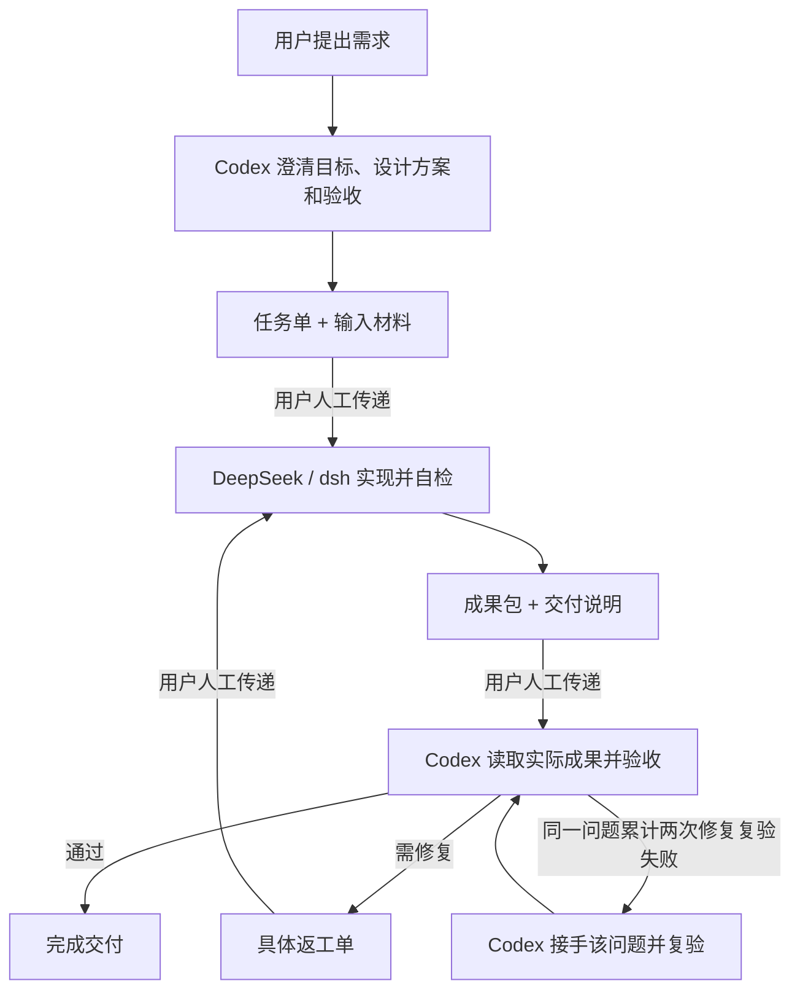

# Codex × DeepSeek 人工交接

让 Codex 负责理解需求、设计方案和验收，让 DeepSeek 通过 dsh 完成实现；你在两者之间传递任务单、材料和成果包。

`codex-deepseek-handoff` 是一套面向 Codex 的协作 Skill，适用于程序、小工具、PPT/课件和调研报告等任务。它把分工落实到可独立执行的任务单、可追踪的验收项和具体返工要求中。

**核心约定：Codex 制定方案并检查实际成果；同一问题的修复提交累计两次经 Codex 复验失败后，由 Codex 接手该问题。**

## 适合什么场景

- 想让 Codex 把需求拆清楚，再交给 DeepSeek 实现。
- 希望任务单离开当前聊天后，仍能被完整理解和执行。
- 需要检查实际文件、页面、运行结果和来源，而不只看“已完成”的回复。
- 想保留需求、版本、问题和返工记录，避免反复解释或修改错版本。
- 愿意人工传递文件，希望先使用轻量的协作流程。

本仓库提供流程指令和参考模板，没有自动通信、调度、计费或后台执行程序，也不包含 dsh。使用时需要分别准备可用的 Codex 和 DeepSeek/dsh 环境。

## 如何协作



| 角色 | 主要职责 |
|---|---|
| Codex | 理解需求、设计方案、定义验收、诊断问题、制定返工方案及必要接手 |
| DeepSeek / dsh | 实现、自检、按返工单修复并整理实际交付物 |
| 用户 | 提供材料、人工传递文件、裁定关键偏好和需求取舍 |

Skill 装在 Codex 侧。DeepSeek 不会自动获得这个 Skill 或 Codex 的聊天历史，因此 Codex 生成的任务单必须自包含。

## 安装

下载本仓库，将包含 `SKILL.md`、`references/` 和 `agents/` 的整个目录命名为 `codex-deepseek-handoff`，放入 Codex 的本地技能目录：

| 安装范围 | 目录 |
|---|---|
| 当前项目 | `<项目目录>/.agents/skills/codex-deepseek-handoff/` |
| 当前用户 | `~/.agents/skills/codex-deepseek-handoff/` |

Windows 用户级目录对应 `%USERPROFILE%\.agents\skills\codex-deepseek-handoff\`。确认 `SKILL.md` 直接位于该目录下，不要多套一层下载目录。技能未出现时，可尝试重启 Codex。安装位置与发现方式见 [OpenAI 官方技能文档](https://learn.chatgpt.com/docs/build-skills)。

本 Skill 本身只有 Markdown 和 YAML 文件，无需安装 Python 或 Node.js 包；执行具体任务所需的软件、依赖、文件权限和联网能力，在开工时实际检查。

## 快速开始

### 1. 在 Codex 中生成任务单

可以直接使用技能名称提出请求；在支持 `$` 技能提及的 Codex CLI 或 IDE 中，也可以使用 `$codex-deepseek-handoff`。不同入口的技能调用方式见 [官方说明](https://learn.chatgpt.com/docs/build-skills)。

例如：

```text
使用 codex-deepseek-handoff skill，帮我生成一份可独立交给 dsh 的任务单。

我要一个在 Windows 上运行的 CSV 汇总工具。
输入表包含“部门”和“金额”两列，按部门汇总金额并输出新的 CSV。
金额保留两位小数；遇到无效金额时停止并报告行号。
不得覆盖已有输出文件。
交付可运行程序、必要源文件和使用说明。
金额精度、输入编码及其他会影响结果的约定，请先明确。
```

同时提供真实输入样例、已有项目和不能改变的约束。Codex 会区分硬要求、合理默认值、实现细节和待确认事项，生成 `任务单.md`，通常在其中直接嵌入验收表。

### 2. 人工交给 DeepSeek / dsh

将任务单和随包材料一起交给 dsh，例如：

```text
请读取随包的任务单.md，按其中约定完成任务。
开工先简短复述目标、交付物、关键约束和执行顺序，并检查输入及环境。
无关键矛盾即执行；发现阻塞时按任务单报告，继续不受影响的部分。
完成后交回实际成果和交付说明.md。
```

不要只发送 Codex 的一段总结，也不要只给 dsh 一个它无法访问的本地路径。

### 3. 把成果交回 Codex 验收

将实际成果、有效任务单和交付说明一起交回：

```text
使用 codex-deepseek-handoff skill，验收这次回传。
请读取有效任务单和实际成果，逐项检查 AC，记录证据及未验证部分，
并回到原始使用目标检查是否满足需求；需要返工时给出具体修复单。
```

如果存在问题，将 Codex 生成的返工单和对应版本文件交回 dsh。复验保留原问题 ID，避免重新命名后丢失失败记录。

## 任务单和成果包里有什么

普通任务只需一份任务单和一份交付说明；验收标准、待确认事项和验收记录按实际需要拆分。

```text
交接目录/
├── 任务单.md
├── 输入材料/
├── 成果/
└── 交付说明.md
```

这只是示例布局，目录和文件名按任务约定。

任务单说明目标、使用场景、输入、环境、方案、可修改范围、任务依赖、验收及回传规则。交付说明列明文件用途、打开或运行方式、自检证据、未完成项和必要限制。

使用稳定 ID 追踪需求和验收：

```text
R-01 用户要求 → T-01 执行任务 → 成果位置 → AC-01 验收项
```

任务单版本描述约定，成果版本标识每次回传，例如 `v1` 对应 `交付-01`、`交付-02`。证据应对应被验收的成果；修改后重新检查受影响部分。

默认回传完整成果包。采用差量包时，明确基线与新增、修改、删除文件；没有随包出现的文件不自动视为删除。保留必要的可编辑源文件和说明，不夹带密钥、缓存、大型依赖目录或无关项目文件。

## 验收与两轮接手

每个验收项使用四种结论：

| 结论 | 含义 |
|---|---|
| 通过 | 实际证据证明符合标准 |
| 不通过 | 存在可复现的不符合结果 |
| 未验证 | 缺环境、材料或权限，当前无法判断 |
| 待用户裁定 | 需要用户决定偏好或需求取舍 |

文件存在、生成成功或 worker 声称测试通过，都不能单独证明交付合格。最终检查实际回传包，并用代表性使用场景核对原始目标；所有必需项通过且没有未解决的目标偏差，才整体通过。

“两轮”按独立问题计算：

1. 首次发现问题，累计失败次数为 0，发出返工要求。
2. dsh 提交针对性修复，Codex 实际复验仍失败，累计为 1。
3. 再次修复提交经 Codex 复验仍失败，累计为 2，由 Codex 接手该问题及必要关联修改。

自检尝试、仅提交诊断、等待材料、无法开展验证及此前未明确交给 worker 的需求遗漏，不算一次修复失败。同一成果的重复检查不重复计数。

原缺陷复发沿用原 ID 并保留失败记录；独立新问题另建关联 ID。接手只针对相关问题，不自动扩展为重做整个项目，也不保证客观阻塞一定能被解决。

## 方案不确定时怎么办

Skill 允许先做范围有限的探索：明确要消除的不确定性、调查证据和停止条件，再决定如何实现。有充分调查支持的“方案不可行”可以是有效探索结论；没有完成调查不能冒充探索完成。

Codex 可以提前验证可行性、纠正方案和补充已有授权范围内的输入，无需先经历两次失败。暂定假设在下游继续保留标记；上游数据、接口或关键决定改变后，追踪报告、图表、代码及验收项的影响并复验。

## 文件导航

```text
codex-deepseek-handoff/
├── README.md
├── SKILL.md
├── agents/
│   └── openai.yaml
└── references/
    ├── task-order.md
    ├── acceptance.md
    └── rework.md
```

| 文件 | 用途 |
|---|---|
| [SKILL.md](SKILL.md) | Codex 使用的入口、分工、阶段选择及核心约定 |
| [task-order.md](references/task-order.md) | 自包含任务单与交付说明骨架 |
| [acceptance.md](references/acceptance.md) | 程序、PPT、课件、调研和混合成果的验收方法 |
| [rework.md](references/rework.md) | 问题计数、返工单、复验及接手规则 |
| [openai.yaml](agents/openai.yaml) | 技能显示名称和简介 |

## 使用边界

- 这是协作指令，执行效果仍取决于模型判断、输入质量和实际工具能力，不能提供程序级强制保证。
- 安装 Skill 不会安装或配置 dsh，也不会赋予文件、联网或外部服务权限。部署、发布、对外发送、购买及系统配置变更仍按用户明确授权执行。
- 本流程考虑 Windows 的路径和 Shell 差异，但具体任务是否可运行需要实际验证，不等于已经完成所有平台的兼容测试。
- 当前已做格式、引用检查和场景推演，尚未完成系统性的真实 dsh 交接效果测试；不承诺固定成功率、节省额度或缩短耗时比例。

本仓库是独立的协作流程说明，不代表 OpenAI 或 DeepSeek 官方项目。具体操作规则以 [SKILL.md](SKILL.md) 及其引用为准；README 用于安装与上手。
